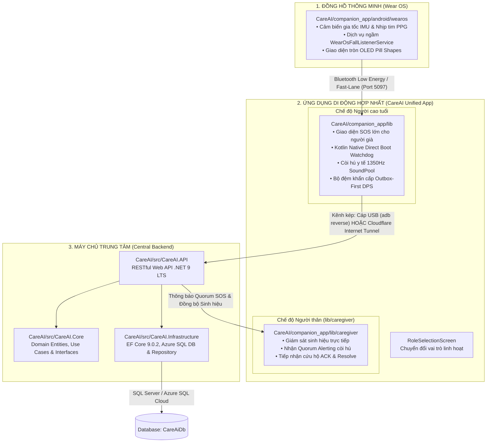

# HƯỚNG DẪN CẤU TRÚC THƯ MỤC & PHÂN HỆ HỆ THỐNG CAREAI v111.0
## (CAREAI SYSTEM ARCHITECTURE, DIRECTORY MAPPING & DEVELOPER ORIENTATION)

> **Tài liệu tham chiếu chuẩn cho toàn bộ lập trình viên, kỹ sư tích hợp và người tiếp nhận dự án.**
> Giải thích chi tiết và phân định minh bạch từng phân hệ: Backend, Frontend, App trung gian (Companion App), App đồng hồ (Wear OS), và App người thân (Caregiver App).
> Toàn bộ giải pháp và mã nguồn được đóng gói độc lập trong thư mục riêng: **`CareAI/`**.

---

## 1. BẢNG TRA CỨU NHANH CÁC PHÂN HỆ (QUICK COMPONENT MAPPING)

| STT | Phân Hệ / Thành Phần | Thư Mục Trong Mã Nguồn | Ngôn Ngữ & Công Nghệ | Vai Trò & Thiết Bị Chạy |
| :---: | :--- | :--- | :--- | :--- |
| **0** | **Solution Tập Trung** | `CareAI/CareAI.slnx` | XML .NET Solution | Quản lý cấu trúc Solution liên kết các dự án C# Backend và Kiểm thử tự động. |
| **1** | **Backend Server** | `CareAI/src/`<br>• `CareAI/src/CareAI.API/`<br>• `CareAI/src/CareAI.Core/`<br>• `CareAI/src/CareAI.Infrastructure/` | C# (.NET 9.0 LTS)<br>EF Core 9.0.2<br>ASP.NET Core Kestrel | **Máy chủ điều phối trung tâm** (Sovereign Modular Monolith). Kết nối CSDL SQL Server / Azure SQL Cloud, xử lý 16 Use Case, xác thực Token SHA-256 (`.ToLowerInvariant()`), phân phối Quorum Alerting. Chạy trên máy tính hoặc máy chủ đám mây. |
| **2** | **Ứng Dụng Di Động Hợp Nhất (CareAI Unified App)** | `CareAI/companion_app/`<br>• `companion_app/lib/`<br>• `companion_app/lib/caregiver/`<br>• `companion_app/android/app/` | Flutter 3.x (Dart)<br>Android Native (Kotlin)<br>Direct Boot Storage | **Ứng dụng di động hợp nhất đa vai trò** (`vn.careai.companion`). Tích hợp 2 chế độ trong cùng một ứng dụng: <br>1. **Chế độ Người cao tuổi**: Nút SOS khẩn cấp, Direct Boot (`CareAiFallStore`), còi hú ICU 1350Hz ISO 60601-1-8 khi phát hiện ngã.<br>2. **Chế độ Người thân**: Giám sát sinh hiệu trực tiếp, nhận Quorum Alerting còi hú khi cụ ngã, tiếp nhận cứu nạn (ACK/Resolve). Chuyển đổi vai trò linh hoạt 2 chiều qua `RoleSelectionScreen`. |
| **3** | **App Đồng Hồ Thông Minh (Wear OS Module)** | `CareAI/companion_app/android/wearos/` | Kotlin Native<br>AndroidX Wear OS<br>Google Health Services | **Bộ viễn trắc cổ tay**. Cài trên đồng hồ thông minh (Samsung Galaxy Watch 4/5/6/7 hoặc Wear OS Emulator). Mặc định chạy dịch vụ nền `WearOsFallListenerService` bảo tồn pin 300mAh. Khi phát hiện té ngã, lập tức kích hoạt rung Haptic và bắn gói tin viễn trắc Fast-Lane sang điện thoại. Giao diện dạng tròn (OLED Capsule Pill Shapes). |
| **4** | **Bộ Kiểm Thử Tự Động (Automated Unit Tests)** | `CareAI/tests/CareAI.UnitTests/` | C# xUnit, FluentAssertions<br>EF Core In-Memory | **Kiểm chứng tính đúng đắn toàn diện** (36/36 Facts Passed). Bảo vệ các bất biến nghiệp vụ, kiểm tra bảo mật BOLA (UC-02), kiểm soát truy cập đồng thời OCC Concurrency `RowVersion`, và chống trùng lặp sự cố (`UIX_Incidents_SingleActiveElder`). |
| **5** | **Tài Liệu Kế Hoạch & Hướng Dẫn Kỹ Thuật** | Thư mục gốc (`/`) | Markdown & Word DOCX | Bao gồm Kế hoạch 4 phần v111.0, Kế hoạch Master v111.0, Tập 1 & Tập 2 chuẩn pháp lý Non-SaMD, Cẩm nang phân hệ, và Hướng dẫn cài đặt môi trường. |

---

## 2. SƠ ĐỒ KIẾN TRÚC DÒNG DỮ LIỆU GIỮA CÁC THƯ MỤC



---

## 3. HƯỚNG DẪN CHI TIẾT TỪNG THÀNH PHẦN

### 3.1 Thư mục Backend (`CareAI/src/`)
- **Vị trí**:
  - `CareAI/src/CareAI.API`: Điểm vào ứng dụng (Entry point), chứa Controllers, Middlewares xác thực thiết bị `X-DeviceId` và SHA-256 token hashing, cấu hình Dependency Injection, và Swagger UI.
  - `CareAI/src/CareAI.Core`: Lớp trung tâm Domain, chứa các thực thể nghiệp vụ (`ElderProfile`, `DeviceRegistration`, `Incident`, `BiometricTelemetry`), các DTOs, và các Interfaces.
  - `CareAI/src/CareAI.Infrastructure`: Lớp hạ tầng, chứa `AppDbContext`, EF Core 9.0.2 Mappings, Filtered Unique Index `UIX_Incidents_SingleActiveElder`, và Triển khai các Repository.
  - File Solution chính: `CareAI/CareAI.slnx`.
- **Cách mở và làm việc**:
  - Dùng **Visual Studio 2022** mở file `CareAI/CareAI.slnx`.
  - Hoặc dùng **VS Code** mở thư mục `CareAI` và dùng extension C# Dev Kit.
- **Lệnh chạy**:
  ```powershell
  dotnet run --project CareAI/src/CareAI.API/CareAI.API.csproj
  ```
- **Kiểm tra trạng thái**: Mở trình duyệt truy cập `http://localhost:5097/health` -> Nhận kết quả `Healthy`.
- **Cấu hình CSDL**: Chỉnh sửa tại `CareAI/src/CareAI.API/appsettings.json` (hỗ trợ chuyển đổi linh hoạt giữa SQL Server Express cục bộ và Azure SQL Database trên Cloud).

---

### 3.2 Thư mục Ứng Dụng Di Động Hợp Nhất (`CareAI/companion_app/`)
- **Vị trí**: `CareAI/companion_app/`
- **Bản chất**: Ứng dụng di động hợp nhất duy nhất (`vn.careai.companion`) tích hợp cả 2 phân hệ qua bộ định tuyến vai trò (`RoleSelectionScreen`):
  - **Chế độ Người cao tuổi (`lib/screens/`, `lib/services/`)**:
    * Màn hình SOS khẩn cấp, nút bấm tactile lớn, hộp thoại đếm ngược 30 giây khi té ngã.
    * Gắn kết trực tiếp hạ tầng Native Android Direct Boot: `PhoneBootReceiver.kt` (`LOCKED_BOOT_COMPLETED`), `FallWatchdogService.kt` (`AlarmManager.RTC_WAKEUP`), `EmergencySoundPlayer.kt` (Còi hú y tế ICU 1350Hz phần cứng `SoundPool`), và `CareAiFallStore.kt` (Device Protected Storage).
  - **Chế độ Người thân / Con cháu (`lib/caregiver/`)**:
    * Đăng nhập / Đăng ký tài khoản người thân (UC-01).
    * Giám sát sinh hiệu trực tiếp (BPM, SpO2, Pin, Bước chân).
    * Nhận còi hú Quorum khẩn cấp khi cụ gặp sự cố ngã (UC-08).
    * Tiếp nhận cứu nạn (ACK) và Đóng sự cố (Resolve) với khóa lạc quan OCC `RowVersion`.
    * Chuyển đổi linh hoạt 2 chiều giữa Chế độ Người cao tuổi và Chế độ Người thân.
- **Cách mở & làm việc**:
  - Mở thư mục `CareAI/companion_app` bằng **Android Studio** hoặc **VS Code**.
- **Lệnh chạy thử nghiệm**:
  ```powershell
  cd CareAI/companion_app
  flutter pub get
  flutter run
  ```

---

### 3.3 Thư mục App Đồng Hồ (`CareAI/companion_app/android/wearos/`)
- **Vị trí**: Nằm bên trong thư mục Android của companion_app (`CareAI/companion_app/android/wearos/`).
- **Bản chất**: Đây là một Gradle sub-module độc lập (`:wearos`) chạy trực tiếp trên hệ điều hành Wear OS của đồng hồ thông minh.
  - `WearOsMainActivity.kt`: Màn hình OLED tròn tối ưu năng lượng hiển thị nhịp tim BPM, nồng độ SpO2 và 2 nút bấm thao tác dạng viên nhộng (Capsule Pills).
  - `WearOsFallListenerService.kt`: Dịch vụ nền bắt tín hiệu gia tốc từ chip cảm biến Sensor Hub.
  - `res/layout/activity_wear_main.xml`: Sử dụng `BoxInsetLayout` với thuộc tính `app:boxedEdges="left|right"` đảm bảo không bị viền tròn của đồng hồ cắt lẹm nội dung.
- **Cách biên dịch độc lập cho đồng hồ**:
  ```powershell
  cd CareAI/companion_app/android
  ./gradlew :wearos:assembleDebug
  ```
- **Cài đặt lên đồng hồ (thật hoặc máy ảo Wear OS)**:
  ```powershell
  adb -s emulator-5554 install -r wearos/build/outputs/apk/debug/wearos-debug.apk
  ```

---

### 3.4 Thư mục Kiểm Thử Tự Động (`CareAI/tests/`)
- **Vị trí**: `CareAI/tests/CareAI.UnitTests/`
- **Vai trò**: Chứa toàn bộ 36 bài kiểm thử xUnit Facts bao phủ 16 Use Case sống còn:
  - Fact 01 – Fact 08: Vòng đời sự cố cứu nạn, kiểm soát trạng thái, khóa lọc `UIX_Incidents_SingleActiveElder`.
  - Fact 09 – Fact 14: Xác thực thiết bị `X-DeviceId`, SHA-256 token lowercase, lọc trùng lặp viễn trắc `ProcessedTelemetryLedgers`.
  - Fact 15 – Fact 20: Bảo mật chống leo quyền BOLA, phân quyền Người thân vs Cụ ông.
  - Fact 21 – Fact 36: Đồng bộ dữ liệu Outbox, Khóa lạc quan OCC `RowVersion`, Lưu mẫu sinh hiệu Fast-Lane (Fact 35).
- **Lệnh chạy kiểm thử**:
  ```powershell
  dotnet test CareAI/CareAI.slnx --nologo
  ```
  *(Yêu cầu bắt buộc: 36/36 Facts Passed 100%, 0 Error, 0 Warning).*

---

## 4. DANH MỤC CÁC TỆP TÀI LIỆU KẾ HOẠCH & CHUẨN MỰC BẮT BUỘC

Tại thư mục gốc của repository, các tệp tài liệu được phân loại rõ ràng:

1. **Bộ Kế Hoạch & Thiết Kế Kiến Trúc Master**:
   - `CareAI_Ke_Hoach_Trien_Khai_4_Phan_v111.md`: Bản Kế Hoạch Triển Khai 4 Phần Cân Bằng & Độc Lập (Phần 1: Viễn trắc & Thích nghi ngưỡng; Phần 2: Trung tâm cấp cứu; Phần 3: Quản trị gia đình; Phần 4: AI/ML).
   - `CareAI_Final_Master_Plan_Airtight_Execution_14_2_3_3.md`: Bản Kế Hoạch Master v111.0 chi tiết hóa toàn bộ các pha triển khai, thông số kỹ thuật và cam kết hệ thống.
   - `CareAI_Tap_1_Yeu_Cau_Kien_Truc_Phap_Ly_Va_Ke_Hoach_Trien_Khai.docx`: Tập 1 chuẩn quy thức – Định vị pháp lý Non-SaMD, Kiến trúc Sovereign Monolith và Đặc tả chi tiết 16 Use Case.
   - `CareAI_Tap_2_Chi_Tiet_Ma_Nguon_CSDL_Va_Kiem_Thu_HIL.docx`: Tập 2 chuẩn quy thức – Chi tiết CSDL quan hệ, mã nguồn từng tầng và 8 kịch bản kiểm thử phần cứng HIL Testing.

2. **Tài Liệu Hướng Dẫn Kỹ Thuật & Cài Đặt Môi Trường**:
   - `HUONG_DAN_SETUP_MOI_TRUONG_VA_CHAY_DU_AN_CAREAI.md`: Cẩm nang cài đặt đầy đủ SDK (.NET 9, Java 21, Flutter 3.x, Android SDK 34/36), biến môi trường, thiết bị thật Android (Samsung Galaxy A55 5G), Wear OS Emulator, hướng dẫn môi trường cho iOS/iPhone, và thiết lập mạng kép (Cáp USB + Cloudflare Tunnel).
   - `HUONG_DAN_CAU_TRUC_THU_MUC_VA_HE_THONG_CAREAI.md`: Hướng dẫn cấu trúc thư mục và phân định phân hệ.
   - `README.md`: Trang chủ repository trên GitHub.

