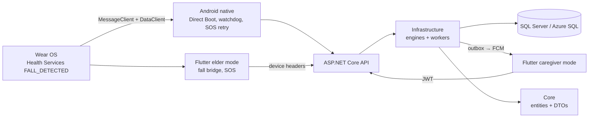

# CareAI — bản đồ hệ thống, workflow và nghiệp vụ

> **Đọc README này trước khi làm việc với repository.** Nội dung phản ánh mã nguồn tại ngày 25/09/2026, kể cả các thay đổi đang có trong working tree. Để sửa một chức năng, tra mục [Nơi bắt đầu theo nhiệm vụ](#nơi-bắt-đầu-theo-nhiệm-vụ) rồi chỉ mở các tệp liên quan. Nếu README và mã nguồn khác nhau, dùng mã nguồn cùng kết quả kiểm tra mới nhất làm căn cứ. Đọc thêm [AGENTS.md](./AGENTS.md) trước khi sửa code.

CareAI hỗ trợ gia đình theo dõi người cao tuổi, nhận tín hiệu SOS/ngã/nhịp tim nguy kịch, ghi nhận sự cố và điều phối người thân tiếp nhận. Đây là **nền tảng hỗ trợ cảnh báo**, không tự chẩn đoán bệnh và không tự gọi cấp cứu. Một ứng dụng Flutter chứa cả vai trò người cao tuổi lẫn người thân; module Wear OS gửi sự kiện ngã sang điện thoại; backend là modular monolith ASP.NET Core.

## Đọc nhanh trong 60 giây

1. **Code chính:** [`CareAI/`](./CareAI/). Backend: `src/`; app: `companion_app/`; test .NET: `tests/`.
2. **Đường dữ liệu:** Wear OS/điện thoại → Flutter hoặc Kotlin Android → API → SQL Server → notification outbox → Firebase Cloud Messaging (FCM) → điện thoại người thân.
3. **Hai danh tính:** người thân dùng JWT; thiết bị đã ghép đôi gửi `X-DeviceId` và `X-Device-Token`. Thao tác theo elder phải kiểm tra `ElderCaregiver.IsActive`.
4. **Đơn vị cấp cứu:** `Incident` có `Open → Acknowledged → Resolved`, timeline, snapshot lúc kích hoạt, vòng cảnh báo và `RowVersion`. Mỗi elder chỉ có tối đa một incident `Open`/`Acknowledged`.
5. **Chống gửi trùng:** gói SOS/nhịp tim khẩn dùng khóa `(DeviceId, PacketId)` trong `ProcessedTelemetryLedgers`. Ngã dùng cùng `FALL_{eventId}` qua Flutter/Kotlin.
6. **Thông báo:** outbox được ghi cùng incident. `SENT` nghĩa là FCM chấp nhận, không chứng minh thông báo đã xuất hiện trên máy.
7. **Kiểm chứng:** chạy test đúng phạm vi; số lượng test hoặc tỷ lệ đạt trong tài liệu cũ không phải kết quả hiện tại.

## Cấu trúc repository

```text
.
├── AGENTS.md                         Quy tắc làm việc với repository
├── README.md                         Bản đồ hệ thống hiện tại
├── HUONG_DAN_CAU_TRUC_THU_MUC_VA_HE_THONG_CAREAI.md
├── HUONG_DAN_SETUP_MOI_TRUONG_VA_CHAY_DU_AN_CAREAI.md
├── CareAI_Final_Master_Plan_Airtight_Execution_14_2_3_3.md
├── phan-2-trung-tam-cap-cuu.md       Kế hoạch/ghi nhận Phần 2
└── CareAI/
    ├── CareAI.slnx
    ├── src/
    │   ├── CareAI.Core/              Entity, enum, DTO
    │   ├── CareAI.Infrastructure/    EF Core, engine, FCM, background workers
    │   └── CareAI.API/               Program, middleware, controllers, cấu hình
    ├── tests/CareAI.UnitTests/       xUnit unit và integration tests
    └── companion_app/
        ├── lib/                      Flutter: vai trò elder, điều hướng chung
        │   ├── caregiver/            Màn hình, model, service vai trò người thân
        │   ├── models/               Gói SOS/telemetry và model thiết bị
        │   ├── screens/              Chọn vai trò, ghép đôi, SOS, đếm ngược ngã
        │   └── services/             API thiết bị, SQLite outbox, sync, bridge ngã
        ├── test/                     Flutter tests
        └── android/
            ├── app/                  Kotlin native điện thoại
            └── wearos/               Module APK Wear OS riêng
```

`ios/`, `linux/`, `macos/`, `windows/`, `web/` trong app phần lớn là Flutter platform scaffolding. Không sửa tệp sinh tự động nếu nghiệp vụ không yêu cầu. Hai tệp Word và các master plan ở thư mục gốc là đặc tả/định hướng; code hiện tại có thể khác. README bên trong `companion_app/` vẫn là mẫu Flutter, không phải tài liệu kiến trúc.

### Ranh giới phụ thuộc



Backend dùng .NET 9 và EF Core 9.0.2 theo `.csproj`; Flutter dùng Dart và dependency trong `pubspec.yaml`; Android/Wear OS dùng Kotlin/Gradle. Không có dependency Riverpod trong app hiện tại. Tên “AI” không đồng nghĩa đã có model ML chạy trong production: các quy tắc nhịp tim hiện nằm trong `ClinicalDiagnosticEngine`.

## Tác nhân và mô hình dữ liệu

| Khái niệm | Ý nghĩa | Nguồn chính |
| --- | --- | --- |
| `Caregiver` | Người thân có tài khoản và JWT, có thể chăm sóc nhiều elder | `Core/Entities/Caregiver.cs`, `AuthController` |
| `ElderProfile` | Hồ sơ elder, địa chỉ, liên hệ, PIN ghép đôi | `Core/Entities/ElderProfile.cs` |
| `ElderCaregiver` | Quan hệ phân quyền; chỉ quan hệ active mới có quyền | `Core/Entities/ElderCaregiver.cs` |
| `DeviceRegistration` | Thiết bị ghép đôi, token băm, trạng thái, heartbeat | `Core/Entities/DeviceRegistration.cs` |
| `HealthMeasurement` | Mẫu sinh hiệu theo thiết bị, loại, thời điểm | `Core/Entities/HealthMeasurement.cs` |
| `ProcessedTelemetryLedger` | Sổ chống xử lý lại; khóa `(DeviceId, PacketId)` | `Core/Entities/ProcessedTelemetryLedger.cs` |
| `Incident` | Sự cố, snapshot, trạng thái, hạn ACK, `RowVersion` | `Core/Entities/Incident.cs` |
| `IncidentTimelineEvent` | Nhật ký sự kiện append-only | `Core/Entities/IncidentTimelineEvent.cs` |
| `NotificationOutbox` | Một thông báo cho một FCM token người thân | `Core/Entities/NotificationOutbox.cs` |
| `ClinicalRuleCooldown` | Mốc hạn chế cảnh báo lặp theo elder và rule | `Core/Entities/ClinicalRuleCooldown.cs` |

`IncidentStatus`: `Open = 1`, `Acknowledged = 2`, `Resolved = 3`. Loại sự cố có `FALL`, `MANUAL_SOS`, cảnh báo nhịp tim và `STALE_OFFLINE`. Server ghi thời gian UTC; Flutter đổi sang giờ thiết bị khi hiển thị.

**Bất biến phải giữ khi sửa code:**

- Filtered unique index SQL Server `UIX_Incidents_SingleActiveElder` trên `ElderProfileId` với `Status IN (1, 2)`. SOS mới khi đã có incident active phải cập nhật incident/timeline đó, không tạo incident active thứ hai.
- `Incident.RowVersion` được API công khai dạng Base64. ACK/Resolve gửi lại phiên bản đã đọc và trả `409` nếu stale.
- Snapshot sinh hiệu, GPS ban đầu và địa chỉ trong incident phản ánh thời điểm kích hoạt. `CurrentGpsLocation`/`CurrentGpsMeasuredAt` ghi vị trí mới nhất khi có SOS/ngã lặp hoặc GPS đến trễ; timeline giữ dấu vết lần cập nhật. `LatestCritical...` và thông tin ACK phục vụ vòng cảnh báo hiện tại; không ghi đè snapshot lịch sử.
- Timeline là append-only; incident `Resolved` không được sửa/xóa theo kiểm tra EF và SQL trigger. Schema bỏ cascade delete ở quan hệ lịch sử liên quan.
- Gói telemetry khẩn giữ cùng `PacketId` khi retry; ledger, mẫu đo, incident, timeline và outbox được lưu cùng `SaveChanges` cho đường khẩn. Giữ mẫu đo đi kèm SOS.
- Mọi endpoint người thân đọc/sửa dữ liệu elder phải xét quan hệ `ElderCaregiver.IsActive`. Không bỏ JWT, middleware thiết bị hoặc việc băm token SHA-256 thành hex chữ thường bằng `.ToLowerInvariant()`.

## Workflow nghiệp vụ

### 1. Tài khoản, hồ sơ, ghép đôi

1. Người thân `POST /api/v1/auth/register` hoặc `/login`; API cấp JWT. Mật khẩu mới dùng PBKDF2; code đăng nhập còn nhánh đọc hash cũ.
2. Người thân `POST /api/v1/caregivers/elders` tạo `ElderProfile`; hệ thống gán họ làm primary caregiver qua `ElderCaregiver`.
3. Người thân `POST /api/v1/devices/generate-pin/{elderProfileId}` lấy PIN 6 số có hiệu lực 10 phút sau khi kiểm tra quyền.
4. App elder `POST /api/v1/devices/pair` với PIN, nhận `DeviceId` và raw device token. Server chỉ lưu SHA-256 hex chữ thường; PIN vô hiệu sau khi dùng.
5. Request thiết bị sau đó gửi đúng `X-DeviceId` và `X-Device-Token`. `DeviceTokenAuthMiddleware` kiểm tra và đặt `ValidatedDeviceId` trong `HttpContext.Items`; controller dùng ID đã xác thực, không tin ID tùy ý trong body.
6. Người thân có thể `POST /api/v1/devices/{deviceId}/revoke`; cache xác thực bị invalidated. App elder lưu dữ liệu ghép đôi trong `SharedPreferences`; native Android đọc cùng preferences khi gửi SOS.

### 2. SOS tay hoặc phát hiện ngã

```text
Wear OS FALL_DETECTED / nút SOS / cảm biến điện thoại
  → đồng hồ gửi MessageClient + DataClient sang điện thoại (nếu từ Wear OS)
  → Kotlin lưu sự kiện ngã vào Device Protected Storage và đặt RTC_WAKEUP watchdog
  → Flutter hiển thị đếm ngược; elder có thể bấm “Tôi ổn”
  → nếu cần cứu trợ: outbox cục bộ và POST /api/v1/incidents/sos
  → TelemetryEngine ghi ledger + mọi mẫu kèm theo + incident/timeline + outbox
  → NotificationDispatcherWorker gửi FCM; caregiver mở chi tiết sự cố
```

`WearOsMessageReceiverService.kt` nhận hai kênh từ đồng hồ. `CareAiFallStore`, `PhoneBootReceiver`, `NativeFallWatchdogReceiver` giữ xử lý qua Direct Boot/khởi động lại; `NativeSosDispatcher` ghi outbox trước khi thử HTTP và dùng WorkManager retry. `FallService` chuyển sự kiện vào Flutter và có thuật toán gia tốc điện thoại dự phòng. `SosButtonScreen` xử lý UI, SOS tay và SQLite. Đường native và Flutter phải dùng cùng `FALL_{eventId}` để tránh sự cố đôi do gửi đồng thời.

### 3. Telemetry và cảnh báo nhịp tim

- `SyncService` ghi mẫu thường vào SQLite `client_packets`, gửi batch qua `POST /api/v1/telemetry/ingest`; Workmanager và timer đồng bộ khoảng 15 phút. Gói offline giữ ID khi retry; bản đã sync được dọn sau 7 ngày.
- Mẫu `HEART_RATE` **≥180 hoặc ≤35 bpm** được gửi ngay tới `POST /api/v1/telemetry/urgent-heart-rate` và vẫn lưu SQLite để retry. Server lưu mẫu cũ gửi muộn nhưng chỉ đánh giá cảnh báo khi thời điểm đo từ 2 phút trước đến 1 phút sau lúc nhận.
- `ClinicalDiagnosticEngine` cảnh báo ở hai ngưỡng critical trên; còn xét tăng ≥15 bpm so với trung vị ít nhất 3 mẫu hợp lệ trong 5 phút khi ít vận động, nhịp cao lúc nghỉ và nhịp thấp. Cooldown 10 phút hạn chế cảnh báo thường lặp; critical mới vẫn có thể báo/tái mở sau ACK.
- Chỉ số nhịp tim là **cảnh báo cần kiểm tra**, không phải kết luận rung thất, vô tâm thu hay chẩn đoán lâm sàng.

### 4. Vòng đời incident và người thân phản hồi

1. Incident mới bắt đầu `Open`. Tín hiệu mới trên incident active thêm timeline và có thể nâng severity; sau ACK, critical mới có thể mở vòng cảnh báo khác (`AlertCycleNumber++`, về `Open`).
2. Người thân liên kết xem `GET /api/v1/incidents/active`, chi tiết và dashboard. `CaregiverPushService` nhận FCM, mở `IncidentDetailScreen`; màn hình có còi Android native và refresh trạng thái mỗi 3 giây để dừng còi khi trạng thái đổi.
3. `POST /api/v1/incidents/{id}/acknowledge` (alias `/ack`) cần JWT, quyền elder, trạng thái `Open` và `RowVersion`. API lưu người/thời gian ACK, timeline, outbox cập nhật; tranh chấp trả `409`.
4. `POST /api/v1/incidents/{id}/resolve` chỉ áp dụng khi `Acknowledged`, cần ghi chú không rỗng và `RowVersion` mới. Sau `Resolved`, lịch sử được giữ bất biến.
5. Người thân có thể mở trình gọi điện cho elder hoặc số cấp cứu từ UI; app không tự gọi.

### 5. Quorum FCM, SLA và mất kết nối

- Engine tạo `NotificationOutbox` cho **mỗi FCM token active** của caregiver liên kết active. `NotificationDispatchEngine` kiểm tra lại quyền/token, dùng `PENDING → PROCESSING → SENT/FAILED/CANCELLED`, lease và retry. `FirebasePushSender` cần Firebase project và Application Default Credentials; thiếu cấu hình thì outbox chờ retry. `SENT` chỉ xác nhận FCM chấp nhận.
- Incident `Critical` có hạn ACK 60 giây từ khi lưu vòng cảnh báo. `AlertSlaEngine` ghi `SLA_BREACHED` và nhắc nếu chưa ACK; mặc định tối đa 3 lần, mỗi 60 giây, có thể chỉnh qua `Alerting` config. ACK dừng nhắc. Không tự gọi 115.
- `WatchdogBackgroundWorker` quét mỗi 60 giây. Nếu **tất cả** thiết bị active không heartbeat quá 5 phút, `DeviceStaleEngine` tạo `STALE_OFFLINE` hoặc ghi vào incident hiện tại. Khi một thiết bị trở lại, `STALE_OFFLINE` được tự đóng; SOS/ngã hiện hành chỉ thêm timeline.
- `DataRetentionBackgroundWorker` dọn `HealthMeasurements` và ledger cũ hơn 30 ngày theo lô mỗi 24 giờ. Incident/timeline không nằm trong đợt dọn đó.

### 6. Lịch sử và dashboard

`GET /api/v1/elders/{elderProfileId}/incidents` (alias `/api/v1/incidents/elder/{elderProfileId}/history`) có BOLA, phân trang `page/pageSize` tối đa 100, lọc `emergencyType`, `severity`, `status`, `fromUtc`, `toUtc`, sắp theo `TriggeredAt` rồi `Id` giảm dần. `GET /api/v1/incidents/{id}` trả timeline, snapshot, trạng thái cảnh báo và nhịp tim `T−15…T+15` phút. `/{id}/heart-rate-series` trả riêng chuỗi đó. Flutter có `IncidentHistoryScreen`, `IncidentDetailScreen`, `HeartRateChartWidget`; dashboard tổng hợp mẫu mới nhất và incident active.

## Hợp đồng HTTP nhanh

Prefix là `/api/v1`. Bảng route không thay thế DTO/validation trong code.

| Route | Ai gọi | Chức năng |
| --- | --- | --- |
| `POST /auth/register`, `/auth/login` | Công khai | Tài khoản/JWT; `AuthController.cs` |
| `GET, POST /caregivers/elders`; `PUT /caregivers/elders/{id}/home-address` | JWT | Hồ sơ elder; `CaregiversController.cs` |
| `POST, DELETE /caregivers/push-token` | JWT | Đăng ký/hủy FCM token; `CaregiversController.cs` |
| `POST /devices/generate-pin/{elderProfileId}`; `POST /devices/{deviceId}/revoke` | JWT | PIN/thu hồi; `DevicesController.cs` |
| `POST /devices/pair` | Công khai + PIN | Ghép đôi; `DevicesController.cs` |
| `POST /devices/heartbeat` | Device headers | Heartbeat; `DevicesController.cs` |
| `POST /incidents/sos` | Device headers | SOS/ngã; `IncidentsController.cs`, `TelemetryEngine.cs` |
| `POST /telemetry/urgent-heart-rate`; `POST /telemetry/ingest` | Device headers | Mẫu khẩn/batch; `TelemetryController.cs` |
| `GET /incidents/active`, `GET /incidents/{id}` | JWT + quyền elder | Danh sách/chi tiết; `IncidentsController.cs` |
| `POST /incidents/{id}/acknowledge` (`/ack`), `POST /incidents/{id}/resolve` | JWT + quyền elder + RowVersion | ACK/đóng; `IncidentsController.cs` |
| `GET /elders/{elderProfileId}/incidents`; `GET /incidents/{id}/heart-rate-series` | JWT + quyền elder | Lịch sử/biểu đồ; `IncidentsController.cs` |
| `GET /dashboard/elder/{elderProfileId}` | JWT + quyền elder | Dashboard; `DashboardController.cs` |
| `GET /health`, `/healthz` | Công khai | ASP.NET health checks; `Program.cs` |

Request/response C# ở `CareAI/src/CareAI.Core/DTOs/`. `IncidentDtoMapper` ánh xạ incident sang API. Khi đổi hợp đồng, cập nhật model/parser Dart trong `lib/models/` hoặc `lib/caregiver/models/` và service gọi API tương ứng.

## Nơi bắt đầu theo nhiệm vụ

| Muốn sửa | Bắt đầu tại | Phải kiểm tra thêm |
| --- | --- | --- |
| Schema/entity | `Core/Entities`, `Infrastructure/Data/CareAiDbContext.cs`, `DatabaseMigrationHelper.cs` | Index, trigger, DB cũ, DTO, test integration |
| Auth/quyền người thân | `AuthController.cs`, `CaregiversController.cs`, `IncidentsController.cs`, `DashboardController.cs` | JWT, `ElderCaregiver.IsActive`, BOLA tests |
| Ghép đôi/xác thực thiết bị | `DevicesController.cs`, `DeviceTokenAuthMiddleware.cs` | Hash chữ thường, header, revoke cache, app preferences |
| SOS/ngã | `TelemetryEngine.cs`, `IncidentsController.cs`, `SosButtonScreen`, `FallService`, Kotlin/Wear OS | Ledger, snapshot, timeline, outbox, Direct Boot/RTC_WAKEUP |
| Nhịp tim | `UrgentTelemetryEngine.cs`, `ClinicalDiagnosticEngine.cs`, `TelemetryController.cs`, `SyncService` | Ngưỡng, mẫu cũ, cooldown, packet ID |
| FCM/SLA | `Infrastructure/Notifications/`, `BackgroundWorkers/`, `caregiver_push_service.dart`, `incident_detail_screen.dart` | Quyền người nhận, ACK race, còi, Firebase config |
| Lịch sử/biểu đồ | `IncidentsController.cs`, `IncidentDtoMapper.cs`, `incident_history_screen.dart`, `heart_rate_chart_widget.dart` | BOLA, phân trang, UTC, thiếu mẫu, bất biến lịch sử |
| Dashboard | `DashboardController.cs`, `caregiver/screens/elder_dashboard_screen.dart` | Mẫu mới nhất, nhiều thiết bị, incident active |

`Program.cs` đăng ký DI, middleware, health checks, hosted services và lúc khởi động gọi `DatabaseMigrationHelper.InitializeDatabaseAsync`. Helper tạo/nâng cấp schema SQL Server bằng script idempotent trong code, không phải thư mục EF migrations chuẩn. Đổi schema phải cập nhật cả EF mapping và đường nâng cấp DB hiện hữu. Kết nối DB lấy từ `ConnectionStrings:DefaultConnection`; JWT/Alerting/Firebase lấy từ ASP.NET configuration. Không đưa connection string, JWT secret, Firebase credential, raw device token hoặc dữ liệu sức khỏe thật vào README, log, test hay commit.

## Chạy và kiểm tra

Chạy từ **thư mục gốc repository** trừ khi có `cd`. Cần .NET 9 SDK, Flutter/Android SDK, Java/Gradle cho Wear OS; backend cần SQL Server hoặc Azure SQL phù hợp. FCM thật cần Firebase project và credential. Xem [hướng dẫn setup](./HUONG_DAN_SETUP_MOI_TRUONG_VA_CHAY_DU_AN_CAREAI.md) để cấu hình môi trường.

```powershell
# Backend
dotnet build CareAI/CareAI.slnx --nologo
dotnet test CareAI/CareAI.slnx --nologo
dotnet run --project CareAI/src/CareAI.API/CareAI.API.csproj
# Sau khi server chạy: GET http://localhost:5097/health

# Flutter, chạy trong CareAI/companion_app
cd CareAI/companion_app
flutter pub get
flutter analyze
flutter test
flutter run

# Wear OS, chạy trong CareAI/companion_app/android
cd android
.\gradlew.bat :wearos:assembleDebug
```

Kiểm tra sát thay đổi trước: `dotnet test CareAI/tests/CareAI.UnitTests/CareAI.UnitTests.csproj --filter "FullyQualifiedName~TenTest" --nologo`, `flutter analyze lib/duong_dan.dart`, hoặc `flutter test test/ten_test.dart`. Integration test SQL Server cần DB phù hợp; kiểm thử FCM, còi, Direct Boot, mạng và Wear OS cần emulator/thiết bị/cấu hình. Không lấy số test trong kế hoạch làm kết quả mới. `/health` hiện là health check ASP.NET trong `Program.cs`, chưa chứng minh DB, FCM hoặc điện thoại hoạt động.

## Giới hạn hiện tại và tài liệu liên quan

- `WearOsMainActivity.kt` hiển thị `76 BPM · 98% SpO2` cố định; đó là UI minh họa, không phải số đo trực tiếp. Wear OS hiện đăng ký `FALL_DETECTED` của Health Services và gửi sự kiện sang điện thoại.
- Flutter chỉ khởi tạo FCM Android khi đủ `--dart-define` `CAREAI_FIREBASE_API_KEY`, `CAREAI_FIREBASE_APP_ID`, `CAREAI_FIREBASE_SENDER_ID`, `CAREAI_FIREBASE_PROJECT_ID`. Server cần `Firebase:ProjectId` (hoặc `GOOGLE_CLOUD_PROJECT`) và Application Default Credentials. Thiếu cấu hình không thể suy ra push thật đã đến máy.
- **Cảnh báo ngã cho người thân ở nền:** backend gửi FCM data message ưu tiên cao cho từng token caregiver đang active. `CaregiverPushService` chuyển sự kiện cho `CaregiverAlertReceiver`; Android tạo thông báo lớn trên kênh `careai_caregiver_alarm_v2` và foreground service phát âm báo lặp. Chạm thông báo mở sự cố; ACK/resolve dừng còi qua push trạng thái; nút **Tắt âm** chỉ tắt tiếng, giữ sự cố đang mở. Nếu Android không cho khởi động foreground service ở nền, app hiển thị thông báo dự phòng với âm báo một lần. Bật quyền thông báo và, trên Android 14+, quyền hiển thị toàn màn hình cho CareAI nếu muốn cảnh báo phủ màn hình khóa.
- **Vị trí và ảnh khi SOS/ngã:** app điện thoại của cụ xin quyền vị trí và camera khi mở màn hình SOS; màn hình này hiển thị GPS đang đo hoặc hướng dẫn bật quyền/định vị. Lúc báo động, app bắt đầu lấy vị trí hiện tại với giới hạn 15 giây; nếu đã có tọa độ đo trong 15 giây gần nhất thì gửi cùng SOS, nếu chưa có thì gửi SOS ngay và bổ sung tọa độ qua `POST /api/v1/incidents/{id}/location` khi máy trả fix mới. Server kiểm tra quyền thiết bị, khoảng thời gian đo và tọa độ hợp lệ, ghi timeline, rồi cập nhật màn hình người thân. DTO cũng ghi cờ vị trí mô phỏng và sai số ước tính; emulator Android chỉ cung cấp vị trí giả do công cụ kiểm thử đặt, nên app gắn nhãn **GPS MÔ PHỎNG** ở cả hai vai trò và không diễn giải tọa độ đó là vị trí thật của cụ. Địa chỉ nhà được chụp từ hồ sơ vào incident tại lúc kích hoạt. Native watchdog cũng thử lấy vị trí hiện tại và gửi bổ sung sau SOS; để hoạt động khi app ở nền, người dùng cần bấm **Bật GPS khi app ở nền** trên điện thoại cụ và cấp quyền **Cho phép mọi lúc** trong Android. Nếu thiếu quyền, Android có thể từ chối truy cập GPS nền; hệ thống không hiển thị tọa độ cũ như tọa độ hiện tại. Sau khi API nhận sự cố, điện thoại cụ tự chụp JPEG độ phân giải thấp và gửi qua `POST /api/v1/incidents/{id}/photo` bằng token thiết bị; ảnh chỉ người thân được phân quyền mới xem qua `GET` cùng route. Ảnh lưu một lần, có SHA-256 và trigger SQL cấm sửa/xóa; upload trễ không cản cảnh báo đầu tiên. Cần cấp quyền camera/vị trí, bật định vị, nhập địa chỉ nhà trong hồ sơ. Android chỉ cho camera hoạt động tự động khi app của cụ đang hiện trên màn hình; khi app ở nền, bị đóng, không có camera hoặc thiếu quyền, sự cố vẫn được gửi nhưng không có ảnh. Wear OS không cung cấp ảnh; camera dùng điện thoại của cụ.
- **Cấu hình để thử push thật:** tạo Firebase project và Android app có package `vn.careai.companion`; lấy bốn giá trị Firebase Options của app rồi chạy Flutter với bốn `--dart-define` trên. Trên máy chạy API, đặt `Firebase__ProjectId` và `GOOGLE_APPLICATION_CREDENTIALS` trỏ tới file service account lưu ngoài repository. Đăng nhập app bằng vai trò người thân để đăng ký FCM token; xác nhận có token active trước khi gửi SOS/ngã. Không đưa service account hoặc token vào Git. Dùng hai điện thoại/emulator đăng nhập hai người thân để đo thời điểm server tạo incident, FCM chấp nhận và từng máy hiện thông báo/phát còi; high priority không bảo đảm một ngưỡng thời gian tuyệt đối trên mọi mạng/thiết bị.
- App có URL USB/tunnel/Wi-Fi thử nghiệm trong `lib/services/api_service.dart`; kiểm tra địa chỉ thực theo môi trường khi triển khai. Native SOS dùng URL lưu lúc ghép đôi. App chưa có Health Connect service hoàn chỉnh dù kế hoạch cũ mô tả mục đó.
- README cũ từng ghi “36/36 facts”, Riverpod và liên kết tới một tệp kế hoạch 4 phần hiện không có trong working tree. Đó không phải mô tả trạng thái code hiện tại.
- [Hướng dẫn cấu trúc cũ](./HUONG_DAN_CAU_TRUC_THU_MUC_VA_HE_THONG_CAREAI.md), [master plan](./CareAI_Final_Master_Plan_Airtight_Execution_14_2_3_3.md), [kế hoạch Phần 2](./phan-2-trung-tam-cap-cuu.md) và hai tệp `.docx` phục vụ bối cảnh. Chúng có thể mô tả chức năng dự kiến hoặc kết quả test tại thời điểm khác. Đối chiếu code và chạy lại kiểm tra trước khi khẳng định đã hoạt động.

**Cách dùng README cho AI ở lần sau:** đọc README và `AGENTS.md`, xác định workflow/tác nhân bị ảnh hưởng, mở đúng tệp ở bảng “Nơi bắt đầu theo nhiệm vụ”, kiểm tra DTO/DB và test gần phạm vi đó. Chỉ mở rộng sang phân hệ khác khi luồng dữ liệu hoặc test cho thấy cần. Khi đổi kiến trúc, route, bất biến hoặc trạng thái triển khai, cập nhật README cùng thay đổi code.
